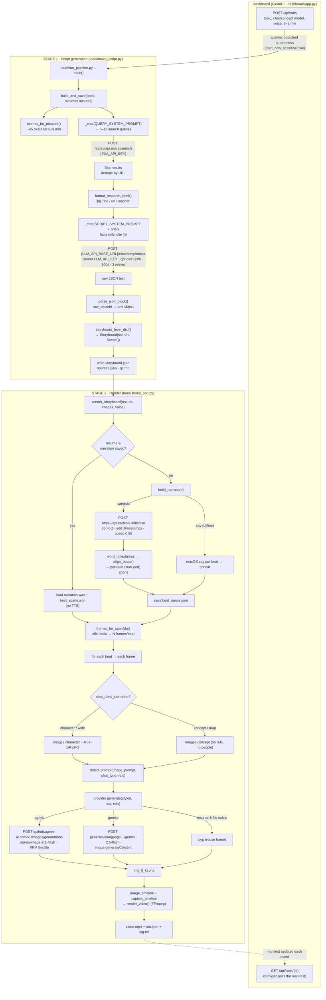
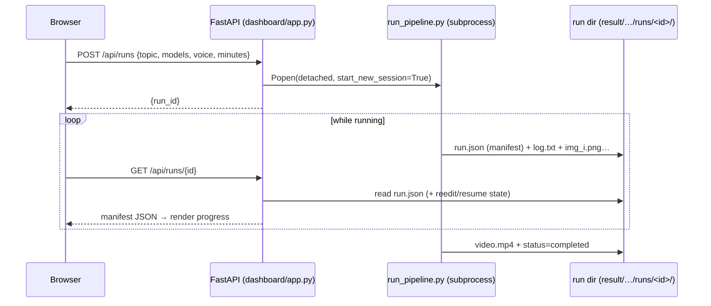
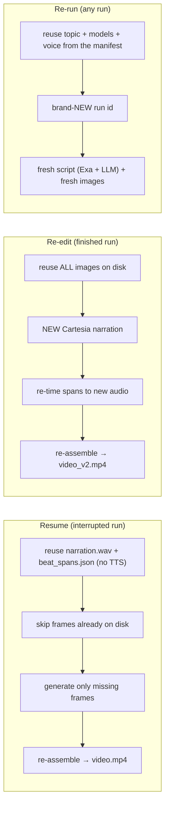

# How a Video Gets Made — End-to-End Pipeline

A detailed, code-accurate walkthrough of everything that happens between "type a topic" and
`video.mp4`: the stages, the exact endpoints hit, the models used, how each prompt is determined, the
env vars required, and the files written. Grounded in the real code (`tools/`, `studio/`, `dashboard/`).

> **Interactive flowchart (Lucid):** the whole pipeline as a colour-coded diagram —
> [view](https://lucid.app/lucidchart/d8bd5573-a728-4e5b-ab4a-a00df8907ed9/view) ·
> [edit](https://lucid.app/lucidchart/d8bd5573-a728-4e5b-ab4a-a00df8907ed9/edit). Covers control
> plane → script (3 LLM calls + Exa) → narration → per-frame image gen → PIL overlays → FFmpeg,
> plus the three post-run paths (Resume / Re-edit / Re-run).

---

## 0. The 30-second mental model

```
topic ─► [research] ─► [script LLM] ─► storyboard.json ─► [narration TTS] ─► [image gen ×N] ─► [FFmpeg assemble] ─► video.mp4
         Exa API        gpt-oss:120b    (Scene[])          Cartesia SSE       Agnes / Gemini      caption overlays
```

Two ingredients drive everything:
1. **Facts** come *only* from real web sources (Exa) → the script LLM may not invent numbers.
2. **Timing** comes from the actual narration audio (Cartesia word timestamps) → images are cut to
   real speech, not guesses.

---

## 1. Full pipeline flowchart



---

## 2. Stage 1 — Topic → Script (the "moat")

**File:** `tools/make_script.py` (orchestration) + `studio/script_prompt.py` (the prompts) +
`studio/research.py` (source model) + `studio/llm.py` (pure request/parse helpers).

### 2a. How many beats? (`scenes_for_minutes`)
`round((min+max)/2 × 60 / 10s per beat)`, floored at 20 → **~45 beats for a 6–9 min video**. Research
depth scales with it: `num_queries = min(12, max(6, num_scenes // 6))`.

### 2b. Search queries (LLM call #1)
| | |
|---|---|
| **Prompt** | `QUERY_SYSTEM_PROMPT` + `build_query_user_prompt(topic, num_queries)` |
| **Endpoint** | `POST {LLM_API_BASE_URL}/chat/completions` (OpenAI-compatible, local Open WebUI/Ollama) |
| **Model** | `LLM_SCRIPT_MODEL` (default `gpt-oss:120b`), temperature `0.3` |
| **Output** | `{"queries": [...]}` → parsed by `parse_json_block` |

### 2c. Real sources (Exa)
| | |
|---|---|
| **Endpoint** | `POST https://api.exa.ai/search` (`ExaResearchProvider.search`) |
| **Auth** | `EXA_API_KEY` |
| **Per query** | `per_query=8` results; deduped by URL across all queries (~50+ sources for a long video) |
| **Brief** | `format_research_brief()` renders each as `[n] Title (date) / url / snippet` so the LLM can cite `[n]` |

### 2d. The script (LLM call #2 — the important one)
| | |
|---|---|
| **Prompt** | `SCRIPT_SYSTEM_PROMPT` (tone + structure + factual rules + scene schema) + `build_script_user_prompt(topic, brief, num_scenes, min, max)` |
| **Endpoint** | `POST {LLM_API_BASE_URL}/chat/completions`, `timeout=300`, **3 retries** on `ReadTimeout`/transport errors |
| **Model** | `gpt-oss:120b`, temperature `0.7` |
| **Hard rules** | Use **only** facts/numbers/dates from the brief; cite each with `[n]`; never invent. Images stay **text-free** (no drawn numbers/words — the image model garbles text). |

**What the LLM must emit** (validated by `storyboard_from_dict` → `Scene` pydantic model):
```json
{"title": "...",
 "scenes": [{"narration": "...", "image_prompt": "subject only, no style words",
             "shot_type": "character|wide|concept|map", "cite": [1,2]}]}
```

### 2e. Parse + persist
- `parse_json_block()` uses `json.JSONDecoder().raw_decode()` from the first `{` — parses exactly one
  object and **ignores any trailing junk** the local model appends (fixed a real "Extra data" crash).
- Writes **`storyboard.json`** (the render input), **`sources.json`** (the Exa citations),
  **`qc.md`** (fact-check gate).

---

## 3. Stage 2 — Storyboard → Video

**File:** `tools/studio_poc.py :: render_storyboard()`.

### 3a. Narration = one continuous track + real per-beat timing
`build_narration(scenes, voice, run_dir)` → `(narration.wav, [(start,end) per beat])`.

| Voice | Endpoint / mechanism | Notes |
|---|---|---|
| **cartesia** (real) | `POST https://api.cartesia.ai/tts/sse` | Model `sonic-2` (`CARTESIA_SSE_MODEL`), voice `CARTESIA_VOICE_ID`, `add_timestamps:true`, `generation_config.speed` = `CARTESIA_SPEED` (0.88, natural slow-down, no atempo artifacts). Streams base64 `pcm_s16le` chunks + `word_timestamps`. |
| **say** (offline) | macOS `say` per beat → `concat_audio` | Free PoC stand-in; spans = cumulative beat durations. |

The whole script is spoken in **one request**, then `align_beats(weights, word_starts, word_ends)`
maps each beat to a real `(start,end)` span (snapped to speech pauses). Spans are persisted to
**`beat_spans.json`** so a **resume reuses them** (no re-synthesis, no drift, no wasted TTS).

### 3b. How many images per beat (pacing)
`frames_for_span(dur)` = `max(1, floor(dur / 8))` → **each frame is held ≥ 8s**; a long beat is split
into that many **distinct, freshly generated** frames (`img_i.png`, `img_i_1.png`, …) — no cut-back,
no repeats.

### 3c. How each image prompt is determined
For every frame:
1. **Role select** — `shot_uses_character(shot_type)`:
   `character`/`wide` → `images.character` provider **with** channel refs (`assets/refs/character.png`,
   `expressions.png`); `concept`/`map` → `images.concept` provider, **no refs, no people**.
2. **Style wrap** — `styled_prompt(image_prompt, style, use_character_ref, shot_type)` (`studio/style.py`)
   appends the locked look and per-shot guardrails:
   - character w/ refs → `CHARACTER_REF_PREAMBLE` ("same character from the reference") + `LOCKED_STYLE` + `FRAME` + `NO_TEXT`
   - concept/map → `CONCEPT_STYLE` + `NO_PEOPLE` + `NO_TEXT` + `FRAME`
   - The scene's `image_prompt` (subject only, from the LLM) is the *only* variable part; **style is never left to the LLM**.

### 3d. Image generation endpoints
| Provider | Endpoint | Model | Auth / notes |
|---|---|---|---|
| **agnes** (default) | `POST https://apihub.agnes-ai.com/v1/images/generations` | `agnes-image-2.1-flash` | `AGNES_API_KEY`; free tier **RPM 20** → one shared `studio.rate_limit.TokenBucket` (not a per-instance sleep) paces every request across the parallel image loop's worker threads + retries; `1024x576` requested but **Agnes ignores it** — probed 2026-08-03, all sizes return 1312×736, so the real upscale to 1920×1080 is ~1.46×, not 1.875× |
| **gemini** | `POST https://generativelanguage.googleapis.com/v1beta/models/gemini-2.5-flash-image:generateContent?key=…` | `gemini-2.5-flash-image` | `GEMINI_API_KEY` (billing); ref-conditioning (REF-1/REF-2); ~$0.039/img |
| **placeholder** | local PIL | — | offline demo, no network |
| **cloudflare** / **hf** | Workers AI FLUX.2 / HF Inference | kept in code, **not offered** (slow / weaker) | — |

Each frame goes through `_generate_frame()` — if the primary provider refuses/fails (e.g. a Gemini
safety block), an optional `--fallback` provider covers it so one bad frame never kills a long run.
On **`--resume`**, a frame whose file already exists is skipped (`if resume and target.is_file()`).

### 3e. Assembly (FFmpeg, `render_video`)
- `image_timeline(beat_spans, frames_per_beat)` → global schedule `(img_file, start, end)`.
- `caption_timeline(beat_spans, narrations)` → short subtitle cues; rendered to transparent PNGs
  (`make_caption_png`, tofu-safe unicode folding) and overlaid via `overlay=0:0:enable='between(t,s,e)'`.
- One FFmpeg pass: loop each image for its span → `concat` → chain caption overlays → mux
  `narration.wav` → `libx264 / yuv420p / aac` → **`video.mp4`**. `ffprobe` measures final duration.

---

## 4. The control plane (dashboard) & run lifecycle



**Endpoints (`dashboard/app.py`):**
| Method + path | Purpose |
|---|---|
| `POST /api/runs` | Start a run (topic → full pipeline, or canned demo). Spawns a **detached** subprocess so edits/reloads never kill it. |
| `GET /api/runs` / `GET /api/runs/{id}` | List / poll a run's manifest (`run.json`) + `reedit`/`resume` availability. |
| `GET /api/runs/{id}/log` · `/file/{name}` | Stream `log.txt` / fetch any run artifact (images, video, storyboard). |
| `POST /api/runs/{id}/resume` | Re-launch with `--resume`: reuse frames **and** saved narration, continue at the first missing frame, record `resume_note`. |
| `POST /api/runs/{id}/reassemble` | Re-edit: reuse images, synth **new** Cartesia audio + retimed assembly (`tools/reassemble.py`). |
| `POST /api/runs/{id}/rerun` | Re-run: start a **fresh** run (new id) reusing this run's topic + models + voice — regenerates script **and** images from scratch. |
| `DELETE /api/runs/{id}` | Remove a run. |
| `GET /` · `/new` | Dashboard + new-run page (per-role model pickers, minutes, subtitles). |

**Run record (`studio/run_log.py`):** every event (`scene_started`, `scene_image`, `scene_rendered`,
`completed`/`failed`, `resumed`) rewrites an immutable `RunManifest` to `run.json` and appends to
`log.txt` — that's exactly what the dashboard polls.

---

## 5. The three post-run paths



- **Resume** = "finish what stopped": identical audio + frames, only the gaps filled. Non-destructive
  (never deletes a frame), and reports `N/M frames on disk — continuing at scene X`.
- **Re-edit** = "same visuals, fresh voice/timing": regenerates audio and re-cuts.
- **Re-run** = "start over cleanly": a new run reusing only the *config* (topic, provider mix, voice)
  — everything (script + images) is regenerated. Duration band + captions fall back to defaults.

---

## 6. Environment variables (all in `.env`, gitignored)

| Stage | Vars |
|---|---|
| Script LLM | `LLM_API_BASE_URL`, `LLM_API_KEY`, `LLM_SCRIPT_MODEL` |
| Research | `EXA_API_KEY` |
| Voice | `CARTESIA_API_KEY`, `CARTESIA_VOICE_ID`, `CARTESIA_SSE_MODEL`, `CARTESIA_SPEED` |
| Images (Agnes) | `AGNES_API_KEY`, `AGNES_IMAGE_MODEL`, `AGNES_SIZE`, `AGNES_MAX_RETRIES` |
| Images (Gemini) | `GEMINI_API_KEY`, `GEMINI_IMAGE_MODEL` |
| Images (others, unused) | `CLOUDFLARE_ACCOUNT_ID`, `CLOUDFLARE_API_TOKEN`, `CF_*`, `HF_TOKEN`, `HF_IMAGE_MODEL` |

---

## 7. Key files

| File | Role |
|---|---|
| `dashboard/app.py` | Control plane: start/poll/resume/re-edit runs (spawns detached subprocesses). |
| `tools/run_pipeline.py` | Orchestrator: `build_and_save` (script) → `render_storyboard` (video). |
| `tools/make_script.py` | Research (Exa) + script LLM calls + parse + write `storyboard.json`/`sources.json`/`qc.md`. |
| `studio/script_prompt.py` | The prompts (query + script) — the moat. |
| `studio/research.py` | `ResearchSource` + brief formatter (`ExaResearchProvider` lives in `make_script.py`). |
| `studio/llm.py` | Pure OpenAI-compatible request build + `parse_json_block` (raw_decode). |
| `studio/storyboard.py` / `studio/types.py` | `Storyboard`/`Scene` models + JSON→objects. |
| `studio/style.py` | Locked visual style + per-shot guardrails (`styled_prompt`). |
| `tools/studio_poc.py` | Providers (Agnes/Gemini/…, Cartesia SSE), narration, pacing, FFmpeg assembly. |
| `studio/narration.py` | `align_beats`, `image_timeline`, `caption_timeline`, `frames_for_span`. |
| `tools/reassemble.py` | Re-edit path (reuse images, new audio). |
| `studio/run_log.py` | Run manifest + log recorder (what the dashboard polls). |
