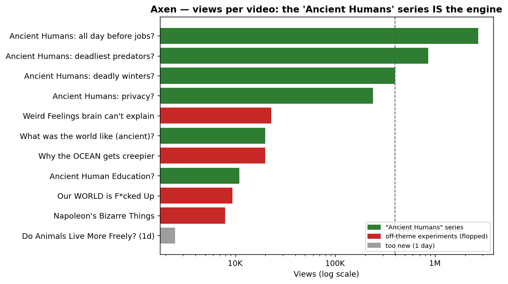

# Reverse-Engineering Report — Axen (@AxenCool)
*In-depth teardown · generated 2026-06-27 · data: NexLev (channel/videos/transcript/multimodal-watch/competitors) · an instance of `context/template/01-target-reverse-engineering`*

## ⚠️ Premise correction (read first)
The working assumption was *"it generates pictures with seamless transitions."* **The data says otherwise.**
A multimodal AI watch-pass of the hero video — **corroborated by NexLev's `format: animation` tag and by
competitors who literally tag themselves "stickman animation"** — shows Axen is **2D minimalist
stick-figure animation**: drawn characters that move, **fast hard cuts (~2–4s/scene, ~18–22 cuts/min)**,
bold on-screen emphasis text, human-sounding narration, upbeat acoustic music. **It is NOT an AI-image
slideshow with morph transitions.** That format you described is a *different* niche (the "documentary"
cluster — AI images + Ken-Burns + AI voice). This matters a lot for automation (see §7), so I'm leading with it.

## 1. Channel snapshot (observed)
| Signal | Value |
|---|---|
| Handle / niche | @AxenCool · history + psychology/philosophy (ancient-humans angle) |
| Age | **~52 days** (joined Apr 28 2026) |
| Subscribers | ~**36.7K–39.9K** (climbing during this analysis) |
| Total views | **~4.36M** |
| Videos | **11** (~1.4/week) |
| Avg video length | **7:42** (462s) — long-form, mid-roll eligible |
| Avg views/video | **~396K** |
| Est. monthly revenue (NexLev) | **~$13,446** · RPM **$4.61** |
| Faceless / on-camera | Faceless · US · business email listed (sponsor-ready) |
| Bio | "I create Videos on Topics I find Interesting :)" (generic, deliberately low-signal) |

**~$13K/mo from 11 videos on a 52-day-old channel** is the headline: extreme revenue-per-asset.

## 2. Format grammar — the "Ancient Humans" question engine
One series carries the entire channel. The **top 4 videos by views are all "How/What Did Ancient
Humans …?"** questions; every off-theme experiment flopped.

| Video | Views | Theme |
|---|--:|---|
| What Did Ancient Humans Do all Day **Before Jobs Existed?** | **2.7M** | ancient ✅ |
| How Did Ancient Humans Survive the **Deadliest Predators?** | 856K | ancient ✅ |
| How Did Ancient Humans Survive **Deadly Winters?** | 397K | ancient ✅ |
| How Did Ancient Humans Have **Privacy?** | 240K | ancient ✅ |
| What Was the World Like in Ancient Human Times? | 20K | ancient |
| Ancient Human Education? | 11K | ancient |
| Weird Feelings Your Brain Can't Explain (psychology) | 23K | off-theme ✗ |
| Why the OCEAN Gets Creepier… | 20K | off-theme ✗ |
| Our WORLD is F*cked Up… | 9.4K | off-theme ✗ |
| Napoleon's Bizarre Things | 7.9K | off-theme ✗ |

**Title formula:** `How/What Did Ancient Humans [handle a relatable MODERN concern]?` — projecting
modern anxieties (jobs, privacy, survival, school) onto prehistory. Curiosity-gap + relatability + evergreen.
**Lesson the data screams:** stay on the vein. Deviations (ocean, Napoleon, generic psychology) cost ~20–100×.

## 3. Script teardown (the real moat) — from the 2.7M hero transcript
The script is a **masterclass retention structure**, not a dry history lesson:

1. **0:00 Immersive 2nd-person hook** — *"You wake up when your body is ready. No alarm, no schedule, no place you need to be."* (you ARE the ancient human).
2. **0:07 Scale reframe** — *"For 99% of human history… 300,000 years."*
3. **0:18 Modern-tension anchor** — *"You spend ~90,000 hours working — a third of your waking life."*
4. **0:34 The question** — *"So what did people actually do all day?"*
5. **0:36 Authority evidence** — Richard Lee's 1963 Ju/'hoansi study (17 hrs/wk for food), cross-validated (Hadza, Aché, Martu). Concrete names, dates, numbers = trust despite faceless.
6. **1:16 Objection handling** — *"But those are modern people…"* → answered with **skeletal evidence** (farmers shorter, cavities, arthritis).
7. **1:51 Emotional turn — art & meaning** — Chauvet Cave (30k yrs), Blombos beads (*"walked 40km for shells just to look good"*), 40k-yr vulture-bone flute. *"For beauty. For meaning. For something to do."*
8. **3:22 Immersive day reconstruction** — dawn → social breakfast → toolmaking → persistence hunting → **6 hrs/day social time** → fireside storytelling (*81% of night talk = stories; "where human culture was born,"* Wiessner 2014) → biphasic sleep.
9. **6:34 The historical turn** — *"Agriculture is a trap"*: population ratchet → harder labor → specialization → **jobs**.
10. **7:40 Existential payoff (callback)** — *"You spend your life chasing an illusion… They woke up already free, already enough… already living the life you're working your entire existence to retire into."* **Mic-drop. No subscribe-CTA.**

**Narration style:** 2nd-person, present-tense immersion · short declaratives · rhetorical questions ·
specific citations for authority · therapeutic/anti-work emotional payoff. This structure is **100% reproducible and automatable** — and it's what separates Axen from the clone swarm.

## 4. Production teardown
| Element | Finding | Confidence |
|---|---|---|
| Visuals | **2D stick-figure animation** (moving limbs/eyes/mouth), minimalist, limited palette | high (watch + tags) |
| Motion | Traditional 2D + simple pans/zooms; **NOT** Ken-Burns-over-photos, **NOT** AI-image morph | high |
| Transitions | **Hard cuts**, instantaneous, fast pace | high |
| Pace | ~2–4s per scene; ~18–22 visual changes/min | high |
| On-screen text | Large bold sans-serif for numbers/names/locations (emphasis) | high |
| Voice | Human-sounding male, American, conversational-authoritative; **no obvious TTS artifacts** (modern TTS could still match) | med |
| Music/SFX | Low upbeat acoustic bed + swish/thud SFX on text | high |
| Branding | No watermark/intro/CTA in the first 2 min or at the end | high |

## 5. Why it works (psychology)
- **Relatability > academia:** it's about *your* burnout/anxiety, framed through history → personal + shareable.
- **Therapeutic payoff:** anti-work, "you're already enough" → emotional resonance, comment-bait, re-shares.
- **Authority via specificity:** real studies/dates/names buy trust for a faceless channel.
- **Calm/"sleepy history" adjacency** (a competitor is *Sleepy Time History*) → long watch sessions → mid-roll-ad friendly → the RPM.
- **Repeatable evergreen series** the algorithm can ride.

## 6. Competitive landscape — a live gold rush (and a warning)
NexLev similar-channel search (118 results) reveals an **exploding micro-niche**: dozens of
**"ancient humans" + stickman-animation** channels, **most 15–58 days old**.

| Closest / notable | Subs | Views | Age | Note |
|---|--:|--:|--:|---|
| **Mack** (sim 78) | 26K | 3.3M | 29d | *"stickman animation"* — Axen's twin; **$9.5K/mo** (also in our top-30) |
| Stickly | 13K | 1.6M | 24d | ancient humans / prehistoric |
| History Alive Animated | 3K | 0.3M | 58d | animated history |
| ThenFolk / Kenn / The Primal Glitch / Cave Explained / Lost Ancient Humans / Ancient Answers | 0–2K | small | 14–49d | **clone swarm forming in real time** |
| Super Joy Animations | **435K** | 58M | 740d | established psychology-animation (the "big" version) |
| Hominid History Hub | 419K | 64M | 345d | human-evolution animation |
| Sleepy Time History | 161K | 17M | 858d | calm/sleep history |

**Read:** the format is proven and easy to enter — but **saturating within weeks**. Two risks: (a) the window
narrows as clones multiply; (b) a swarm of near-identical templated channels invites YouTube's
inauthentic-content scrutiny. **The defensible edge is script quality + the existential payoff + voice** — the
things the low-effort clones won't nail.

## 7. Automation assessment (your 80–95%, quality-preserving, ≥ equivalent goal)
Here's the honest fork the premise-correction creates:

### Path A — Replicate Axen *exactly* (stick-figure animation)
| Stage | Auto? | Note |
|---|---|---|
| Script (the moat) | ✅ ~90% | LLM + **RAG for real citations** + human fact-check (the citations are load-bearing) |
| Voice | ✅ | AI TTS (ElevenLabs-class) matches the calm-authoritative read |
| **Animation** | 🔴 **bottleneck** | Stick-figure characters that *move* are NOT trivially automated at this quality |
| Edit / text / music | ✅ | templated |
→ **Realistic automation ~75–85%.** The animation is the human ~15–25% (template a puppet/asset library in After Effects/Animate to push it up). Quality bar = script + animation polish.

### Path B — Your original idea: AI-image documentary (images + Ken-Burns + AI voice)
→ **~92–95% automatable** (no animation labor). **But** it's a *different, blander* look, **more saturated**,
and arguably **lower-retention** than animation for this audience. Matches "equivalent revenue" only if niche/RPM hold;
unlikely to match Axen's *specific* engagement.

### Path C — **Recommended hybrid:** Axen's script/voice/niche + a *simplified, automatable* visual system
Keep the **winning script formula + calm voice + ancient-humans/existential niche**, but render with a
**consistent AI-illustrated character set + light/limited motion** (or a small puppet-template library) instead of
full frame-by-frame animation. Target **~85–90% automation while keeping the lively, non-slideshow feel** that
makes Axen work. This is the "equivalent or better" path: **better scripts than the clones, near-Axen visuals, high automation.**

## 8. Recommendation & the decision for you
- **The niche is hot but saturating fast** — if you want it, move now, and **differentiate on script + payoff**, not on being yet another stickman clone.
- **The transferable, fully-automatable moat is the SCRIPT STRUCTURE** (hook → authority evidence → emotional reconstruction → existential payoff) + the calm authoritative voice. That scales infinitely and is what beats the swarm.
- **One decision unlocks the build:** which **visual production path** — **A** (replicate animation, ~80% auto, animation is the human cost), **B** (AI-image documentary, ~95% auto, different look), or **C** (hybrid: Axen's script + simplified automatable visuals, ~85–90%, recommended)?

## Appendix — sources
- Channel/videos/about, outliers (none at current thresholds), full hero transcript (`TQd2k1pEXp4`),
  one multimodal watch-pass (first 125s), competitor job (118 similar channels). All via NexLev.
- Data are estimates where noted; visual style is from the watch-pass + format tags, not full-length viewing.
