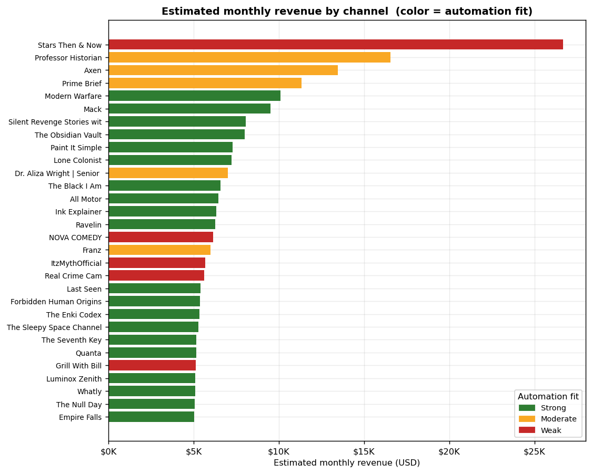
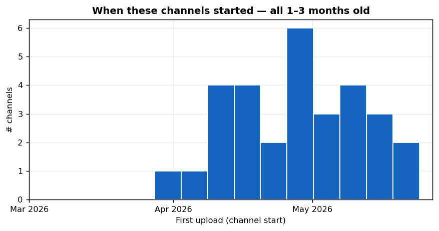
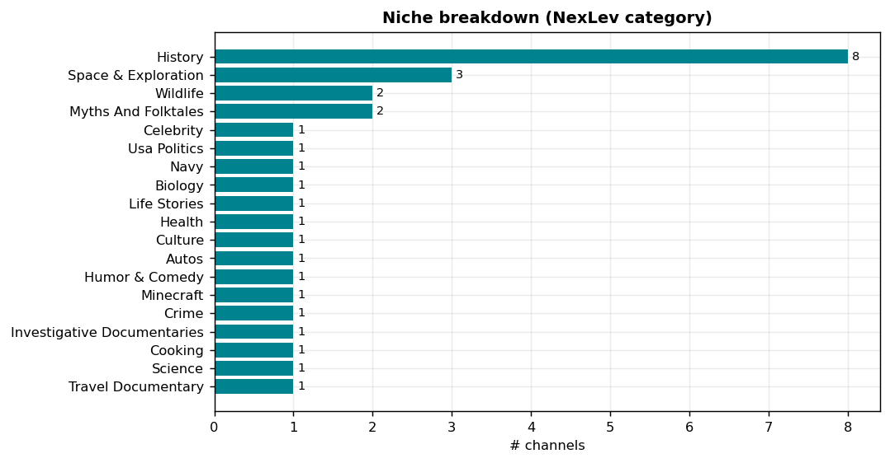
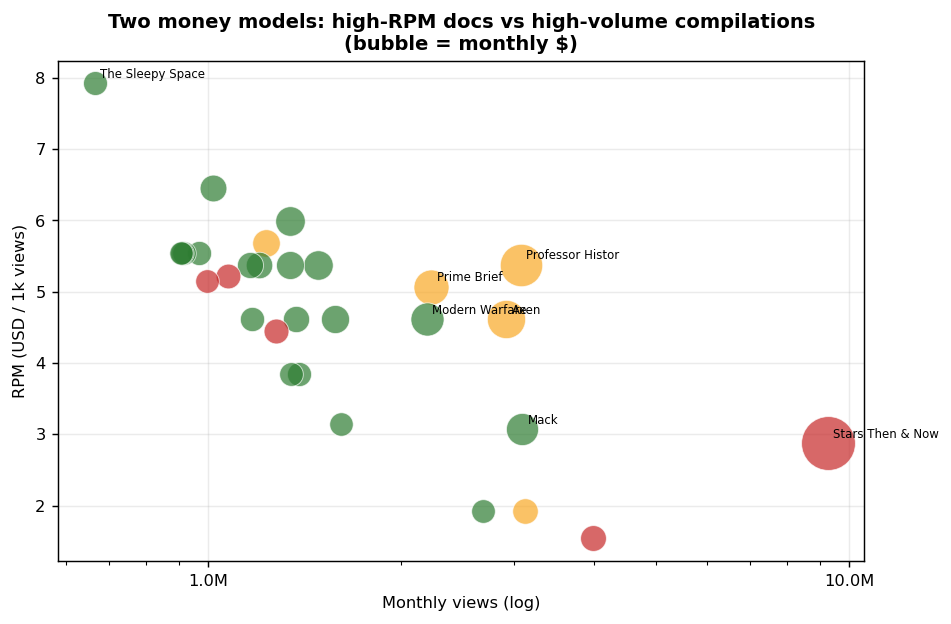
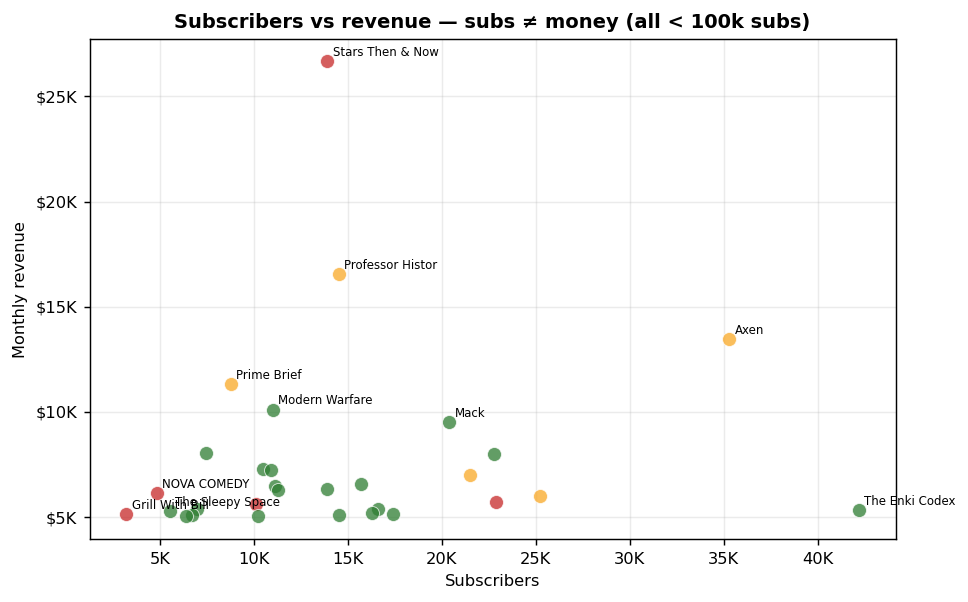
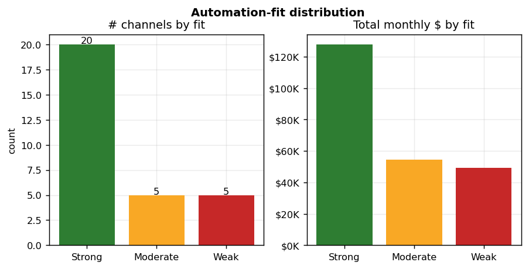

# Report — Brand-New YouTube Channels Already Earning $5k+/mo
*Generated 2026-06-27 · source: NexLev niche-finder · 0 additional credits (built from one query)*

**One-line:** 30 channels that are **<100k subscribers**, **started 1–3 months ago**, and **estimated >$5,000/month** —
a screen for "breakout rockets" worth modeling. **All 30 are faceless.** The dominant, most-automatable pattern is the
**faceless documentary / explainer** (history, space, science, stories).

## Methodology & caveats
- **Query (NexLev `search_niche_finder_channels`, filter-only):** `maxSubscribers=100000`, `firstUploadAfter=2026-03-27`,
  `firstUploadBefore=2026-05-27`, `minMonthlyRevenue=5000`, `limit=30`. 53 channels matched; the top 30 by revenue are shown.
- **Revenue/RPM are NexLev *estimates*** (AdSense = views × RPM), not actuals; treat as directional.
- **Automation-fit is inferred from each channel's niche/format**, not from watching the videos. Verifying a specific
  channel (sample video + transcript) is a 1-credit follow-up.
- Defaults used (per your steer): existing data only (no extra credits); **balanced** shortlist lens; production target =
  **fully-automated faceless AI**, with automation % assessed **per channel**.

## Key findings
- **100% faceless** — to reach $5k/mo within 1–3 months, no-face is effectively mandatory.
- **Revenue range $5,026–$26,665/mo** (median **$6,263**), on **<100k subs** (3K–42K).
- **Faceless documentary/explainer dominates** — niches: History (8), Space & Exploration (3), Wildlife (2), Myths And Folktales (2), Celebrity (1), Usa Politics (1). These also carry the **higher RPMs ($5–$8)**.
- **Two money models** (see chart): high-RPM docs (~$5–8 RPM, ~1M views) vs high-volume compilations (~$1.5–3 RPM, 3–9M views).
- **Automation fit:** **20 Strong**, 5 Moderate, 5 Weak — Strong-fit channels alone represent
  **$127,699/mo** of estimated revenue.

## The automation thesis (can we hit "equivalent or better" at 80–95% automation?)
**Yes — for the documentary/explainer/story lane.** That format is *narration over visuals*, which maps cleanly to a
faceless-AI pipeline:

| Stage | Automated? | How |
|---|---|---|
| Topic / trend pick | ✅ | LLM + NexLev outliers/niche signals |
| Script | ✅ | LLM (long-form narration) |
| Voice | ✅ | AI TTS (e.g. ElevenLabs-class) — the quality lever |
| Visuals (B-roll/images) | ✅/🟡 | stock footage + AI images + Ken-Burns; curation is light-touch |
| Edit / assemble | ✅ | templated FFmpeg / editor |
| Title · thumbnail · captions | ✅ | LLM + template (thumbnail = the other quality lever) |
| Publish + analytics loop | ✅ | platform API + feedback to weights |
| **Human 5–20%** | — | **fact-check (esp. history/health), voice/thumbnail QC** |

**Quality is not compromised** because the two things viewers judge — *voice* and *thumbnail/hook* — get the human's
small share of attention, while everything mechanical is automated. **Weak-fit** channels (compilations, gaming, cooking)
are excluded: they need reused/captured footage (copyright + quality risk) or original on-camera material.

## Shortlist — good fits for 80–95% automation (25 of 30)
*Strong = ~92% automatable, clean original-script narration. Moderate = ~80–85%, extra human QC (accuracy/animation).*

| Channel | Niche | $/mo | RPM | Fit | Auto% | Why |
| --- | --- | --- | --- | --- | --- | --- |
| Professor Historian | history | $16,542 | $5.38 | Moderate | 82% | Animation quality is hard to fully automate at par (AI animation still maturing) |
| Axen | history | $13,446 | $4.61 | Moderate | 82% | Animation quality is hard to fully automate at par (AI animation still maturing) |
| Prime Brief | usa politics | $11,313 | $5.07 | Moderate | 82% | Automatable but timeliness + factual-accuracy QC raise the human share |
| Modern Warfare | navy | $10,103 | $4.61 | Strong | 92% | Narration-over-stock/AI-visuals: AI script+voice+B-roll covers it cleanly |
| Mack | biology | $9,505 | $3.07 | Strong | 92% | Narration-over-stock/AI-visuals: AI script+voice+B-roll covers it cleanly |
| Silent Revenge Stories with Mom | life stories | $8,052 | $5.99 | Strong | 92% | Narration-over-stock/AI-visuals: AI script+voice+B-roll covers it cleanly |
| The Obsidian Vault | history | $7,986 | $5.38 | Strong | 92% | Narration-over-stock/AI-visuals: AI script+voice+B-roll covers it cleanly |
| Paint It Simple | history | $7,280 | $4.61 | Strong | 92% | Narration-over-stock/AI-visuals: AI script+voice+B-roll covers it cleanly |
| Lone Colonist | space & exploration | $7,219 | $5.38 | Strong | 92% | Narration-over-stock/AI-visuals: AI script+voice+B-roll covers it cleanly |
| Dr. Aliza Wright | Senior Health | health | $6,994 | $5.68 | Moderate | 80% | YMYL accuracy: script must be fact-checked by a human → higher QC |
| The Black I Am | culture | $6,580 | $6.45 | Strong | 92% | Narration-over-stock/AI-visuals: AI script+voice+B-roll covers it cleanly |
| All Motor | autos | $6,452 | $5.38 | Strong | 92% | Narration-over-stock/AI-visuals: AI script+voice+B-roll covers it cleanly |
| Ink Explainer | history | $6,325 | $4.61 | Strong | 92% | Narration-over-stock/AI-visuals: AI script+voice+B-roll covers it cleanly |
| Ravelin | history | $6,263 | $5.38 | Strong | 92% | Narration-over-stock/AI-visuals: AI script+voice+B-roll covers it cleanly |
| Franz | wildlife | $5,990 | $1.92 | Moderate | 82% | Animation quality is hard to fully automate at par (AI animation still maturing) |
| Last Seen | investigative documentaries | $5,398 | $4.61 | Strong | 92% | Narration-over-stock/AI-visuals: AI script+voice+B-roll covers it cleanly |
| Forbidden Human Origins | history | $5,367 | $5.54 | Strong | 92% | Narration-over-stock/AI-visuals: AI script+voice+B-roll covers it cleanly |
| The Enki Codex | myths and folktales | $5,333 | $3.84 | Strong | 92% | Narration-over-stock/AI-visuals: AI script+voice+B-roll covers it cleanly |
| The Sleepy Space Channel | space & exploration | $5,276 | $7.92 | Strong | 92% | Narration-over-stock/AI-visuals: AI script+voice+B-roll covers it cleanly |
| The Seventh Key | myths and folktales | $5,167 | $3.84 | Strong | 92% | Narration-over-stock/AI-visuals: AI script+voice+B-roll covers it cleanly |
| Quanta | wildlife | $5,148 | $1.92 | Strong | 92% | Narration-over-stock/AI-visuals: AI script+voice+B-roll covers it cleanly |
| Luminox Zenith | space & exploration | $5,092 | $5.54 | Strong | 92% | Narration-over-stock/AI-visuals: AI script+voice+B-roll covers it cleanly |
| Whatly | science | $5,080 | $3.15 | Strong | 92% | Narration-over-stock/AI-visuals: AI script+voice+B-roll covers it cleanly |
| The Null Day | history | $5,047 | $5.54 | Strong | 92% | Narration-over-stock/AI-visuals: AI script+voice+B-roll covers it cleanly |
| Empire Falls | travel documentary | $5,026 | $5.54 | Strong | 92% | Narration-over-stock/AI-visuals: AI script+voice+B-roll covers it cleanly |

**Excluded (5):** compilation/celebrity/clip channels (reused-content + copyright risk), gaming, and cooking/reviews
(need captured footage) — automatable in parts, but not without compromising quality or rights.

## Recommendation
Model the **faceless documentary/explainer** lane — specifically the **Strong-fit, higher-RPM** examples
(Modern Warfare, Mack, Silent Revenge Stories with Mom, The Obsidian Vault, Paint It Simple). It is the niche with (a) the most fresh winners here, (b) RPM that clears
$5k/mo on ~1M views, and (c) a format that a faceless-AI pipeline can match or beat. Next step: pick ONE target and
reverse-engineer it (template `01`) — I can pull its sample videos + transcript (1 credit) to confirm the format before building.

## Appendix A — all 30 channels
| # | Channel | Subs | $/mo | Mo views | RPM | Started | Category | Format | Outlier | Fit | Auto% |
| --- | --- | --- | --- | --- | --- | --- | --- | --- | --- | --- | --- |
| 1 | Stars Then & Now | 14K | $26,665 | 9.3M | $2.88 | 2026-04-06 | celebrity | compilation | 6.0 | Weak | 65% |
| 2 | Professor Historian | 14K | $16,542 | 3.1M | $5.38 | 2026-04-27 | history | animation | 2.7 | Moderate | 82% |
| 3 | Axen | 35K | $13,446 | 2.9M | $4.61 | 2026-04-28 | history | animation | 2.3 | Moderate | 82% |
| 4 | Prime Brief | 9K | $11,313 | 2.2M | $5.07 | 2026-05-14 | usa politics | news | 16.8 | Moderate | 82% |
| 5 | Modern Warfare | 11K | $10,103 | 2.2M | $4.61 | 2026-04-27 | navy | documentary | 5.0 | Strong | 92% |
| 6 | Mack | 20K | $9,505 | 3.1M | $3.07 | 2026-05-24 | biology | educational | 10.6 | Strong | 92% |
| 7 | Silent Revenge Stories with Mom | 7K | $8,052 | 1.3M | $5.99 | 2026-05-18 | life stories | stories | 1.3 | Strong | 92% |
| 8 | The Obsidian Vault | 23K | $7,986 | 1.5M | $5.38 | 2026-04-19 | history | documentary | 0.6 | Strong | 92% |
| 9 | Paint It Simple | 10K | $7,280 | 1.6M | $4.61 | 2026-04-29 | history | educational | 14.4 | Strong | 92% |
| 10 | Lone Colonist | 11K | $7,219 | 1.3M | $5.38 | 2026-04-09 | space & exploration | educational | 0.5 | Strong | 92% |
| 11 | Dr. Aliza Wright | Senior Health | 22K | $6,994 | 1.2M | $5.68 | 2026-05-05 | health | educational | 0.1 | Moderate | 80% |
| 12 | The Black I Am | 16K | $6,580 | 1.0M | $6.45 | 2026-05-12 | culture | stories | 0.8 | Strong | 92% |
| 13 | All Motor | 11K | $6,452 | 1.2M | $5.38 | 2026-03-28 | autos | documentary | 0.1 | Strong | 92% |
| 14 | Ink Explainer | 14K | $6,325 | 1.4M | $4.61 | 2026-04-09 | history | educational | 7.3 | Strong | 92% |
| 15 | Ravelin | 11K | $6,263 | 1.2M | $5.38 | 2026-05-11 | history | documentary | 1.4 | Strong | 92% |
| 16 | NOVA COMEDY | 5K | $6,125 | 4.0M | $1.54 | 2026-04-12 | humor & comedy | compilation | 384.5 | Weak | 65% |
| 17 | Franz | 25K | $5,990 | 3.1M | $1.92 | 2026-04-29 | wildlife | animation | 1.2 | Moderate | 82% |
| 18 | ItzMythOfficial | 23K | $5,690 | 1.3M | $4.45 | 2026-04-11 | minecraft | gaming | 26.9 | Weak | 70% |
| 19 | Real Crime Cam | 10K | $5,619 | 1.1M | $5.22 | 2026-04-18 | crime | compilation | 2.3 | Weak | 65% |
| 20 | Last Seen | 17K | $5,398 | 1.2M | $4.61 | 2026-04-24 | investigative documentaries | documentary | 5.1 | Strong | 92% |
| 21 | Forbidden Human Origins | 7K | $5,367 | 968K | $5.54 | 2026-05-12 | history | documentary | 0.5 | Strong | 92% |
| 22 | The Enki Codex | 42K | $5,333 | 1.4M | $3.84 | 2026-04-27 | myths and folktales | documentary | 0.8 | Strong | 92% |
| 23 | The Sleepy Space Channel | 6K | $5,276 | 666K | $7.92 | 2026-05-07 | space & exploration | documentary | 0.4 | Strong | 92% |
| 24 | The Seventh Key | 16K | $5,167 | 1.3M | $3.84 | 2026-05-04 | myths and folktales | documentary | 1.2 | Strong | 92% |
| 25 | Quanta | 17K | $5,148 | 2.7M | $1.92 | 2026-04-18 | wildlife | educational | 0.6 | Strong | 92% |
| 26 | Grill With Bill | 3K | $5,120 | 995K | $5.15 | 2026-04-21 | cooking | reviews | 0.8 | Weak | 70% |
| 27 | Luminox Zenith | 7K | $5,092 | 919K | $5.54 | 2026-05-20 | space & exploration | documentary | 1.2 | Strong | 92% |
| 28 | Whatly | 14K | $5,080 | 1.6M | $3.15 | 2026-05-05 | science | educational | 1.1 | Strong | 92% |
| 29 | The Null Day | 10K | $5,047 | 910K | $5.54 | 2026-05-15 | history | documentary | 1.1 | Strong | 92% |
| 30 | Empire Falls | 6K | $5,026 | 907K | $5.54 | 2026-04-17 | travel documentary | documentary | 1.9 | Strong | 92% |

*Full machine-readable data: `result/channels_full.csv` · `result/data/channels.json`. Regenerate: `python result/generate_report.py`.*
